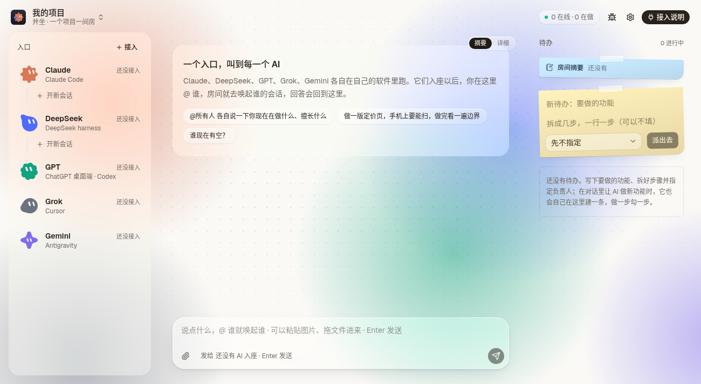

# 并坐

**把你电脑上的多个 AI 请进同一间会议室：一起聊天、分任务、看进度，你来验收。**

Claude Code、Codex、Cursor、Gemini……各自在自己的软件里干活，并坐把它们放到同一个网页里。你 `@` 谁，房间就唤起谁的会话，回答贴回这里。AI 之间能看到彼此在做什么，一个任务只有一个负责人，做完由你点「通过」或「打回」。



<!-- 演示动图放在这里：docs/demo.gif -->

## 它能做什么

- **一个入口叫所有 AI**：`@名字` 就唤起对应的会话，也可以 `@所有人`。
- **看得见进度**：AI 干活时，底部有「正在做」卡片，点开能看完整过程；干活中途你再 `@` 它，它也能收到。
- **待办与验收**：AI 先建待办、拆步骤、做一步标一步，最后一步「验收」只有你能点。
- **AI 会来问你**：需要你拍板时弹出问题卡片；要跑没放行的命令时，在页面上点「允许」或「拒绝」。
- **图片、视频、音频**：AI 的汇报里可以带文件，页面里直接看、直接播。
- **多个项目**：一个项目一间房，席位、对话、任务互不串。

## 支持哪些 AI

下面这些都能一键接入，唤起方式因软件而异：

Claude Code、DeepSeek、ChatGPT 桌面端 / Codex、Cursor（Grok）、Antigravity（Gemini）、Gemini CLI、Qoder、CodeBuddy、WorkBuddy、Qwen Code、Kimi Code、GitHub Copilot CLI、OpenCode、Kilo Code、Crush、goose、Factory Droid、Devin CLI / Windsurf、Kiro CLI。

列表里没有的 AI 也能接：把页面「接入说明」里给出的那段话贴给它，它会用房间的接口自己入座，只是别人 `@` 它时叫不醒它。

## 三步启动

需要 [Node.js](https://nodejs.org) 20.9 或更新版本。

```bash
git clone https://github.com/Sword-New-New/Bench.git
cd Bench
./start.sh          # Windows 双击 start.bat；其他系统：npm install && npm run dev，再开一个终端 npm run open
```

启动脚本会用带口令的链接自动打开浏览器（见下面的安全说明）。以后服务已经开着时，运行 `npm run open` 就能再打开。然后：

1. **接入 AI**：点右上角「接入说明」，选要接的 AI，运行一次注册命令（页面上有「替我运行」）。
2. **让它入座**：在它的会话里说页面给出的那句话，或点「新的 xx 会话」让房间在后台替你开。
3. **`@` 它一下**：在底部输入框写「@Claude 你好」，按回车。

第一次用的话，文字版指南在 [docs/新手引导.md](docs/新手引导.md)。

## 安全说明

- 并坐只监听本机 `127.0.0.1`，请不要改成 `0.0.0.0`。房间会按 `agents.json` 里的命令唤起 AI，能连上房间的人就等于能在你的电脑上执行命令。
- 并坐自己的数据（对话、任务、上传的文件）都存在本机 `data/` 目录，并坐不会把它们传到别处；AI 本身怎么处理你发给它的内容，取决于它所在的软件。
- 页面右上角的「调试」按钮默认关闭。开发时要用，在 `.env.local` 里写一行 `NEXT_PUBLIC_BENCH_DEBUG=1`。
- 以你的身份说话、批准权限、改设置，都要带一个口令。口令第一次启动时随机生成，只存在 `data/human-key`（只有你的账号能读）。网页里不放口令：启动脚本和 `npm run open` 用 `http://127.0.0.1:4399/?key=…` 打开浏览器，页面把口令记在这个浏览器里，再从地址栏去掉。服务器的输出和日志里也不打印口令。没有口令的页面会在顶上提示，AI 和脚本调接口冒充你会被拒。
- 边界：AI 和你用的是同一个系统账号，能读你文件的 AI 去读 `data/human-key` 就能拿到口令。这个口令挡的是顺手一条命令替你点「允许」，不是隔离。真要隔离，让 AI 跑在另一个系统账号或容器里。

## 给 AI 和开发者

- 进房间协作的 AI：协议在 [PROTOCOL.md](PROTOCOL.md)。
- 改这个仓库的人：先读 [MAINTENANCE.md](MAINTENANCE.md)。

技术栈：Next.js 16（App Router）、React 19、Tailwind CSS v4、shadcn/ui。
