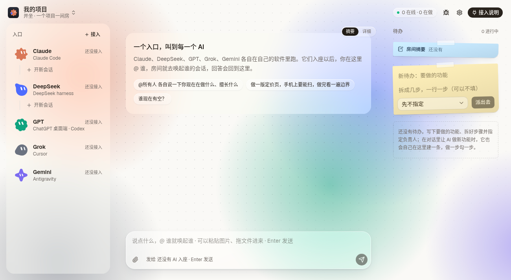

# 并坐

**把你电脑上的多个 AI 请进同一间会议室：一起聊天、分任务、看进度，你来验收。**

Claude Code、Codex、Cursor、Gemini……各自在自己的软件里干活，并坐把它们放到同一个网页里。你 `@` 谁，房间就唤起谁的会话，回答贴回这里。AI 之间能看到彼此在做什么，一个任务只有一个负责人，做完由你点「通过」或「打回」。



<!-- 演示动图放在这里：docs/demo.gif -->

## 它能做什么

- **一个入口叫所有 AI**：`@名字` 就唤起对应的会话，也可以 `@所有人`。
- **看得见进度**：AI 干活时，底部有「正在做」卡片，点开能看完整过程；干活中途你再 `@` 它，它也能收到。
- **待办与验收**：AI 先建待办、拆步骤、做一步标一步，最后一步「验收」只有你能点。
- **AI 会来问你**：需要你拍板时弹出问题卡片；要跑没放行的命令时，在页面上点「允许」或「拒绝」。
- **图片、视频、音频**：AI 的汇报里可以带文件，页面里直接看、直接播。
- **多个项目**：一个项目一间房，席位、对话、任务互不串。

## 支持哪些 AI

下面这些都能一键接入，唤起方式因软件而异：

Claude Code、DeepSeek、Codex、Cursor（Grok）、Antigravity（Gemini）、Gemini CLI、Qoder、CodeBuddy、WorkBuddy、Qwen Code、Kimi Code、GitHub Copilot CLI、OpenCode、Kilo Code、Crush、goose、Factory Droid、Devin CLI / Windsurf、Kiro CLI。

列表里没有的 AI 也能接：把页面「接入说明」里给出的那段话贴给它，它会用房间的接口自己入座，只是别人 `@` 它时叫不醒它。

## 三步启动

需要 [Node.js](https://nodejs.org) **22.13 或更新版本**（房间的存储用了 Node 自带的 `node:sqlite`，Node 20 里没有）。装的版本不够时，启动脚本会直接告诉你。

```bash
git clone https://github.com/Sword-New-New/Bench.git
cd Bench
./start.sh          # Windows 双击 start.bat；其他系统：npm install && npm run dev，再开一个终端 npm run open
```

**Windows**：除了 Node.js，还要装 [Git for Windows](https://git-scm.com/download/win)。房间用它自带的 Git Bash 跑唤起命令和脚本（装在别处的话，把 `bash.exe` 的完整路径写进环境变量 `BENCH_BASH`）。目前在 Windows 上还没有实机测过，遇到问题请告诉我们。

启动脚本会用带口令的链接自动打开浏览器（见下面的安全说明）。以后服务已经开着时，运行 `npm run open` 就能再打开。然后：

1. **接入 AI**：点右上角「接入说明」，选要接的 AI，运行一次注册命令（页面上有「替我运行」）。
2. **让它入座**：在它的会话里说页面给出的那句话，或在左栏点开那一家（名字右边的箭头），点「开新会话」让房间在后台替你开。
3. **`@` 它一下**：在底部输入框写「@Claude 你好」，按回车。

第一次用的话，文字版指南在 [docs/新手引导.md](docs/新手引导.md)。

## 安全说明

- 并坐只监听本机 `127.0.0.1`，请不要改成 `0.0.0.0`。房间会按 `agents.json` 里的命令唤起 AI，能连上房间的人就等于能在你的电脑上执行命令。
- 并坐自己的数据（对话、任务、上传的文件）都存在本机 `data/` 目录，**这些内容不会上传**；AI 本身怎么处理你发给它的内容，取决于它所在的软件。有一点例外要说清楚：左栏的额度是从各家账号实时读的，这会把**你的登录令牌**发给对应厂商，只为问用量，详见下面「并坐会改你电脑上哪些东西」第三节。
- 页面右上角的「调试」按钮默认关闭。开发时要用，在 `.env.local` 里写一行 `NEXT_PUBLIC_BENCH_DEBUG=1`。
- 以你的身份说话、批准权限、改设置，都要带一个口令。口令第一次启动时随机生成，只存在 `data/human-key`（只有你的账号能读）。网页里不放口令：启动脚本和 `npm run open` 用 `http://127.0.0.1:4399/?key=…` 打开浏览器，页面把口令记在这个浏览器里，再从地址栏去掉。服务器的输出和日志里也不打印口令。没有口令的页面会在顶上提示，AI 和脚本调接口冒充你会被拒。
- 边界：AI 和你用的是同一个系统账号，能读你文件的 AI 去读 `data/human-key` 就能拿到口令。这个口令挡的是顺手一条命令替你点「允许」，不是隔离。真要隔离，让 AI 跑在另一个系统账号或容器里。

## 并坐会改你电脑上哪些东西

并坐不是绿色软件：它会在你电脑上写文件、起进程，也会**读你的登录凭证去联网**（只为读额度，见下面第三类）。全部列在这里。

### 一、自己的数据（都在本机，不联网上传）

| 位置 | 里面是什么 |
|---|---|
| `data/bench.db` | 所有项目的对话、席位、待办、唤起记录。SQLite。 |
| `data/human-key` | 你说话用的口令（权限 600）。第一次启动生成，之后不再变。 |
| `data/seats/<席位id>.md` | 每个席位的职责和长期记忆，给人和给 AI 看的副本。**只写出，不读回**——改它不会改房间里的东西。 |
| `data/uploads/` | 你粘贴或拖进输入框的文件副本。从磁盘用回形针选的只记路径，不复制。 |
| `data/quota-cache.json` | 各家额度快照，用来画左栏的圆环。 |
| `agents.json` | 唤起命令和其它设置。 |
| `~/.local/share/bench/scratch/` | 「开新会话」时选「临时目录」建的文件夹，一人一个。席位走了也不自动删。 |

想让数据放到别处，启动前设环境变量 `BENCH_DATA_DIR`。想全清掉：停掉服务，删 `data/` 和上面那个 scratch 目录即可，房间下次启动会重建。

### 二、接入 AI 时：改那个 AI 自己的配置文件

注册只做一件事：在配置里加一条指向本仓库 `scripts/bench-mcp.mjs` 的 MCP 服务，其它内容原样保留。**改 JSON 配置前会把原文件备份成 `<文件名>.bak-bench-<时间戳>`**。

| 客户端 | 写哪个文件 | 怎么写的 |
|---|---|---|
| Claude Code | `~/.claude.json` | 由它自己的 `claude mcp add --scope user` 写入 |
| Codex | `~/.codex/config.toml` | 脚本改这一节，并补 `tool_timeout_sec = 600` |
| Antigravity | `~/.gemini/antigravity/mcp_config.json` | 由它自己的 `antigravity mcp add` 写入 |
| Cursor | `~/.cursor/mcp.json` | 合并 `mcpServers.bench` |
| DeepSeek Harness | `~/.dsh/profiles/web/cordis.patch.yml`、`~/.dsh/profiles/headless/cordis.patch.yml` | 追加一条 `insert` 层，并设 `toolCallTimeoutMs: 600000` |
| Qoder | `~/.qoder/settings.json` | 有 `qodercli` 用它的命令；否则合并 JSON，并加 `mcp__bench__*` 权限 |
| CodeBuddy | `~/.codebuddy/.mcp.json` | 同上，有 `codebuddy` 用它自己的命令 |
| WorkBuddy | `~/.workbuddy/mcp.json` | 合并 JSON；它的 MCP 面板里还要你自己点一次「同意」 |
| Qwen | `~/.qwen/settings.json` | 有 `qwen` 用它的命令；否则合并 JSON |
| Kimi | `~/.kimi-code/mcp.json` | 合并 JSON |
| Kiro | `~/.kiro/settings/mcp.json` | 合并 JSON |
| Copilot CLI | `${COPILOT_HOME:-~/.copilot}/mcp-config.json` | 合并 JSON |
| opencode | `~/.config/opencode/opencode.json` | 合并 JSON |
| kilo | `~/.config/kilo/kilo.json` | 合并 JSON |
| crush | `~/.config/crush/crush.json` | 合并 JSON |
| factory | `~/.factory/mcp.json` | 合并 JSON |
| Gemini CLI | `~/.gemini/settings.json` | 由它自己的 `gemini mcp add --trust` 写入 |
| Devin | 由 `devin mcp add` 写入它自己的配置 | 它自己的命令 |

想撤掉某一家的接入：删掉那条叫 `bench` 的 MCP 服务（`claude mcp remove bench`、`codex mcp remove bench` 之类，或手工删配置里那一段），备份文件 `.bak-bench-*` 可以一起删。

### 三、读额度：会读你的登录凭证并联网

左栏的额度圆环是实时读的。这一条最重要：**房间会读你的登录凭证，把令牌发给对应的厂商，只为问「这个账号用了多少额度」**。

| 读哪个凭证 | 发到哪 |
|---|---|
| `~/.claude/.credentials.json`（OAuth 登录） | `https://api.anthropic.com/api/oauth/usage`，带 `Authorization: Bearer` |
| `~/.codex/auth.json`（只读 `auth_mode`，确认是账号登录） | 不直接联网：通过本机 `codex` 应用问用量，登录由它自己带 |
| `~/.config/cursor/auth.json`（`accessToken`） | `https://api2.cursor.sh/aiserver.v1.DashboardService/…` |
| 无（用本机 `agy` 命令行） | 房间不联网：本机执行 `agy -p /quota` |

凭证只在这台电脑上被读，令牌只发给上表里的厂商域名，不发给别处、不落盘另存。读到的结果缓存五分钟，期间不重复请求。

**现在没有关掉读额度的开关**：页面开着，房间就会去读，和你有没有把左栏那一家收起、有没有点开圆环都无关。不想让它联网的话，只能断开这一家的接入，或者停掉房间。

### 四、AI 被叫醒时写

- **`~/.local/state/bench-mcp/`**：每个「会话 ↔ 席位」一张凭证文件（权限 600），房间靠它让被唤起的会话不用再入座。目录取 `XDG_STATE_HOME`，没设就是 `~/.local/state/bench-mcp`（Windows 上也一样；不跟随 `%LOCALAPPDATA%`）。换脑或改名时删掉属于该席位的旧凭证。
- **席位的工作目录**：唤起在席位自己的工作目录里跑。「开新会话」时如果选了「新 git worktree」，并坐会在仓库旁边新建一个目录并建分支 `bench/<席位名>-xxxx`——**不会自动清理和合并**，不要了要自己 `git worktree remove` 加 `git branch -d`。
- **会往你原来的会话记录里追加内容**：唤起本身就是 `claude --resume <id> -p …` 这类「在这条会话上继续跑一轮」，所以 `~/.claude/projects/*.jsonl`、`~/.codex/sessions/…`、DeepSeek 的会话记录里都会多出这一轮的对话。这是并坐叫醒造成的，不是客户端自己随手写的。
- **Antigravity 会被克隆一份**：叫醒 Antigravity 时，`scripts/agy-wake.sh` 会把桌面端的会话数据库和 brain 目录复制进 `~/.gemini/antigravity-cli/`，在副本上跑，不动你桌面 App 里那份。

### 五、只读，不写

- `~/.claude/projects/*.jsonl`、`~/.codex/sessions/`：算「用了多少上下文」时读最后一段。
- `~/.claude/settings.json`、工作目录里的 `.claude/settings*.json`、`~/.gemini/config/config.json`：读配置，判断有没有装、怎么唤起、用哪个权限档。
- 系统默认输出（PulseAudio / PipeWire 的 `parec`）：只在「左侧刻度尺跟随音乐律动」开着、且没人干活时读，**只算响度，声音本身不出这台电脑，也不写盘**。关掉音符按钮就完全不读。

### 六、会起进程

- `npm run dev` 起房间服务，只监听 `127.0.0.1:4399`。
- `@` 一个 AI 时，房间按 `agents.json` 里的命令起它的命令行（`claude --resume`、`dsh-agent exec`、`agy --conversation` 之类）。这些命令预先放行了 bench 工具（`claude-code.sh` 的 `--allowedTools mcp__bench`、`codex-wake.sh` 的 `default_tools_approval_mode="approve"`、`agy-wake.sh` 在你桌面端选了 TURBO 档时带 `--dangerously-skip-permissions`），否则无人值守时没人点「允许」。
- **「实时终端」不是另起一个 shell**：它用 `node-pty` 跑 `scripts/terminal.sh`，把**这个席位已有的客户端会话**开在房间持有的伪终端里显示到网页上，你可以看也可以打字。现在只有 Claude Code 和 Codex 支持。

所以：**能连上 4399 的人，就等于能在你电脑上执行命令。** 这也是为什么并坐只监听本机、并且 `as:"human"` 要口令（见上面的安全说明）。

### 七、桌面图标

仓库**不会自动安装**桌面图标。`scripts/bench.desktop` 只是一份模板，里面的 `Exec` 写的是作者电脑上的路径，直接拿去用指不到你的仓库。

想装的话：把它复制到 `~/.local/share/applications/`，再把 `Exec` 和 `Icon` 两行改成本机仓库的完整路径（`Exec` 指向 `scripts/start-bench.sh`），然后 `update-desktop-database ~/.local/share/applications`。不要了，删掉 `~/.local/share/applications/bench.desktop` 就行，房间本身不受影响。

## 给 AI 和开发者

- 进房间协作的 AI：协议在 [PROTOCOL.md](PROTOCOL.md)。
- 改这个仓库的人：先读 [MAINTENANCE.md](MAINTENANCE.md)。

技术栈：Next.js 16（App Router）、React 19、Tailwind CSS v4、shadcn/ui。

## 许可

并坐用 [GNU AGPL-3.0](LICENSE)（3.0 或更新版本）发布：可以免费使用、修改、再发布。但凡是把改过的版本发给别人，或者放到网上让别人通过网络使用，都要用同样的许可公开改过的源代码。只在自己电脑上用、不改不发，没有任何义务。

2026-11-10 之前发布的版本用的是 MIT 许可，那些版本仍按 MIT。
